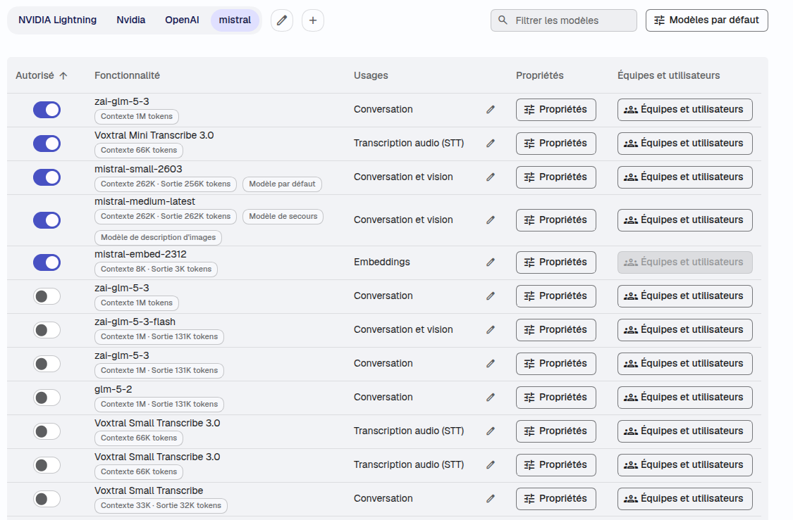
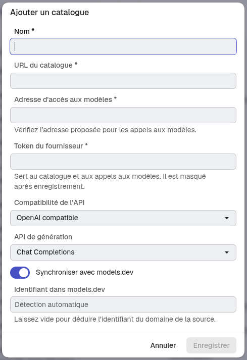
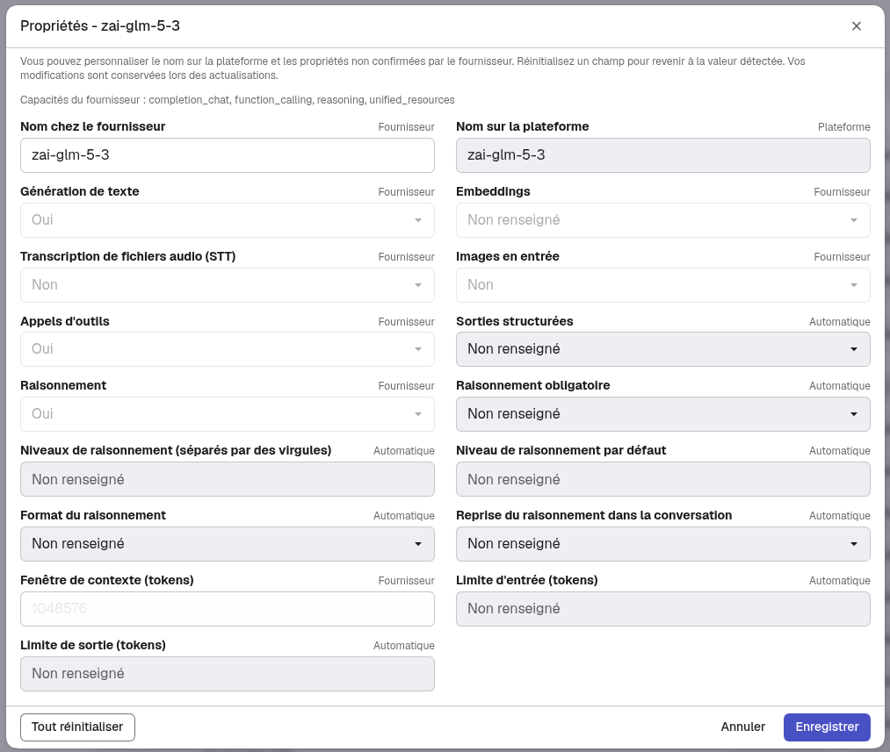
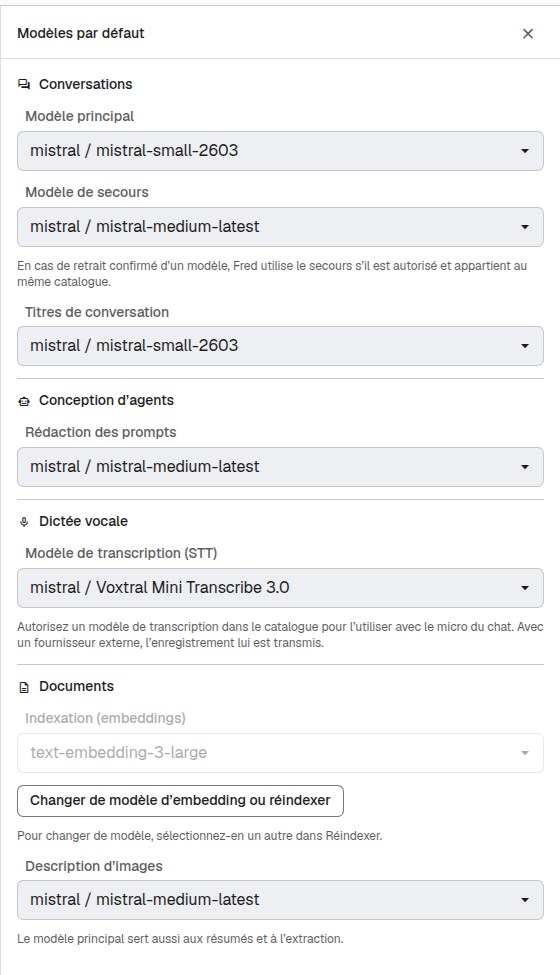
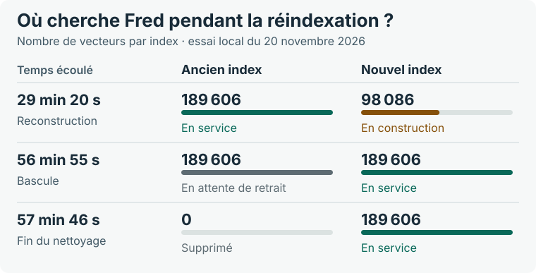

« Si une région entière tombe en panne, où se trouve la copie de nos données ? » Pour répondre, un assistant doit retrouver le bon passage dans un guide de stockage, puis expliquer ce qu'il a lu. Dans Fred, deux modèles peuvent se partager ce travail. Si la question est dictée, un troisième modèle intervient pour la transcrire.

Pour la personne qui pose la question, tout tient dans une seule conversation. Pour l'organisation qui exploite Fred, chaque étape soulève un choix. À qui confier l'audio ? Quel modèle rédigera la réponse ? Que deviendront les documents si l'on change le modèle qui sert à les retrouver ? Voici comment la version de développement de Fred Weaver rend ces décisions visibles.

**Sommaire** · [Catalogue](#catalogue) · [Propriétés](#proprietes) · [Choix du modèle](#choix-du-modele) · [Réindexation](#reindexation) · [Résultats de l’essai](#resultats)

## Quels modèles une équipe peut-elle utiliser ? {#catalogue}

Dans la vue **Modèles**, chaque onglet correspond à une source. Sous l'onglet Mistral de notre installation, on trouve côte à côte Voxtral pour la transcription, un modèle de conversation capable de lire des images et un modèle d'indexation documentaire. La colonne **Usages** indique ce que chacun sait faire. L'interrupteur **Autorisé** indique ce que l'organisation a décidé d'ouvrir. Et le badge **Modèle par défaut** désigne celui qui répondra en l'absence de choix plus précis.

<figure>
  
  <figcaption>Voxtral et mistral-small sont tous deux autorisés. Leurs usages expliquent pourquoi un seul des deux peut rédiger la réponse.</figcaption>
</figure>

Une organisation peut connecter son propre catalogue ou déclarer un modèle précis par son identifiant. Le formulaire distingue l'adresse où Fred lit la liste des offres de celle où il enverra les requêtes. Cette distinction compte quand un fournisseur expose son inventaire et ses modèles à deux adresses différentes. Après la découverte, le responsable de l'organisation choisit les modèles à autoriser. Pour les conversations, il peut en limiter l'accès à certaines équipes ou aux espaces personnels. Un projet peut ensuite resserrer le choix hérité de son équipe.

<figure style="max-width:30rem;margin-inline:auto">
  
  <figcaption>La connexion se configure une fois pour la source. Les équipes retrouvent ensuite ses modèles sous le nom donné au catalogue.</figcaption>
</figure>

## Que sait faire chaque modèle ? {#proprietes}

Ouvrons **Propriétés** sur la première ligne du catalogue. Pour ce modèle, le fournisseur confirme la génération de texte, l'appel d'outils et le raisonnement. La prise en charge des sorties structurées reste inconnue. Cette nuance intéresse directement une équipe qui veut confier à son assistant le remplissage d'un formulaire.

<figure>
  
  <figcaption>La provenance apparaît à côté de chaque champ. On peut ainsi distinguer une capacité confirmée d'une information à compléter.</figcaption>
</figure>

Les propriétés confirmées par le fournisseur font référence. Une synchronisation facultative avec models.dev peut enrichir la fiche, et l'organisation peut compléter les informations manquantes ou donner au modèle un nom plus parlant. Ces compléments sont conservés lors des actualisations. Quand elle est connue, la licence du modèle est également consultable depuis sa fiche.

## Quel modèle répond dans le chat ? {#choix-du-modele}

Les **Modèles par défaut** donnent une fonction aux offres autorisées. Dans l'exemple ci-dessous, Voxtral transcrit la question dictée, Mistral Small sert de modèle principal pour la conversation et Mistral Medium aide à rédiger les instructions d'un nouvel agent. L'indexation des documents utilise encore un autre modèle. L'organisation peut donc changer sa dictée sans avoir à recalculer sa bibliothèque.

<figure style="max-width:35rem;margin-inline:auto">
  
  <figcaption>Suivre la ligne « Dictée vocale » ou « Indexation » permet de savoir à quel modèle Fred confie cette partie du travail.</figcaption>
</figure>

Pour rédiger une réponse, Fred prend d'abord **le modèle choisi dans le chat**. Sans choix explicite, il utilise la recommandation de l'agent, puis, si elle manque, le modèle par défaut de l'espace le plus proche (projet, puis équipe), et enfin celui de l'organisation. Au début du tour, Fred vérifie que le choix est permis et utilisable. Un choix interdit bloque la demande. Le modèle de secours peut prendre le relais si le fournisseur retire le modèle retenu. Ce remplaçant doit être autorisé, disponible et rattaché au même catalogue et au même compte.

## Comment changer de modèle tout en gardant la recherche disponible ? {#reindexation}

La recherche documentaire repose sur des *embeddings*. Pour chaque passage, le modèle calcule une suite de nombres qui représente son sens. À la recherche, il fait le même calcul pour la question. Fred peut alors retrouver, parmi les documents accessibles à la personne, un passage sur la « réplication géographique » lorsqu'elle demande où se trouve la copie de ses données. Chaque modèle apprend ses propres coordonnées. Si l'on change de modèle pour la question, il faut recalculer celles des passages avec ce même modèle.

Fred reconstruit donc un **second index** à partir des passages déjà publiés, pièces jointes comprises. Les fichiers originaux, le découpage et les droits sont conservés. Pendant le calcul, la recherche continue de consulter l'index actif. Les nouvelles indexations et les modifications de visibilité dans la recherche attendent. En cas d'échec, la reconstruction peut reprendre au dernier point enregistré. Une fois le nouvel index prêt, Fred active ensemble le modèle et l'index correspondant, puis supprime l'ancien index.

## Que révèle l’essai sur 502 documents et 30 questions ? {#resultats}

Les 502 documents de notre essai totalisaient **environ 9 millions de mots**, soit l’équivalent de 30 000 pages à raison de 300 mots par page. Le corpus réunissait les documentations de MDN, de Kubernetes et d’Azure ainsi que 19 PDF. Le 20 novembre 2026, nous l’avons réindexé sur une installation locale avec OpenSearch.

Les **189 606 passages** sont passés de `mistral-embed` (1 024 coordonnées) à `text-embedding-3-large` (3 072). Pendant la reconstruction, l'assistant a retrouvé le fichier Kubernetes attendu dans l'ancien index. La bascule a eu lieu après **56 min 55 s**, puis le nettoyage a été confirmé **51 s** plus tard. Le contrôle final a retrouvé exactement les mêmes identifiants de passage. Cette continuité a un coût temporaire. À 480 documents traités, les deux index occupaient ensemble 18,95 Go de stockage primaire, hors répliques et fichiers sources.

<figure>
  
  <figcaption>L'ancien index répond encore aux recherches alors que le nouveau contient déjà 98 086 vecteurs. Tous deux sont complets à la bascule.</figcaption>
</figure>

Nous avons posé les mêmes 30 questions au même assistant, dans des conversations distinctes, avec le même modèle de réponse. Seul le modèle utilisé pour l'indexation et la recherche a changé dans ce protocole.

| Sur 30 questions | Avant | Après |
| --- | ---: | ---: |
| Conversations terminées sans erreur d'exécution | 30 | 30 |
| Questions ayant donné lieu à une recherche documentaire réussie | 28 | 28 |
| Réponses citant le fichier attendu | 22 | 23 |
| Réponses jugées entièrement correctes | 17 | 15 |
| Réponses jugées partielles | 13 | 15 |

Revenons à la question de départ. Lors des deux passages, l'assistant a cité le bon guide Azure et expliqué la copie entre zones. À chaque fois, il a laissé de côté la copie vers une autre région. Pour la personne qui prépare un plan de continuité, c'était précisément l'information qui manquait.

La campagne permet de vérifier la bascule passage par passage. Avec une seule réponse par question et par modèle, elle ne permet pas de classer les deux modèles. Elle montre en revanche pourquoi nous suivons deux résultats distincts après une réindexation. L'assistant retrouve-t-il la bonne source, et répond-il à toute la question ?
