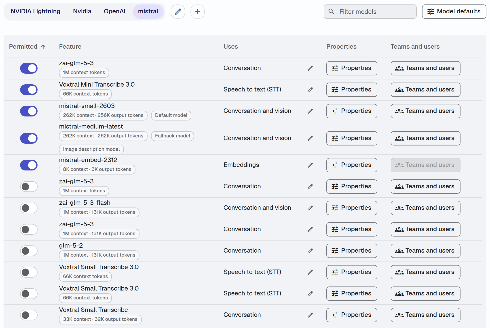
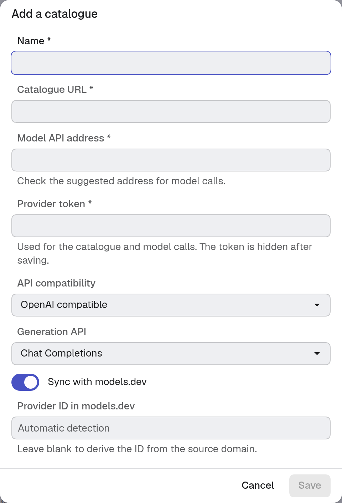
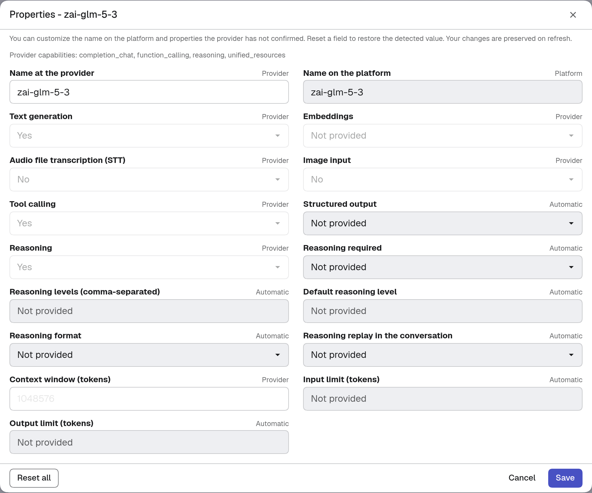
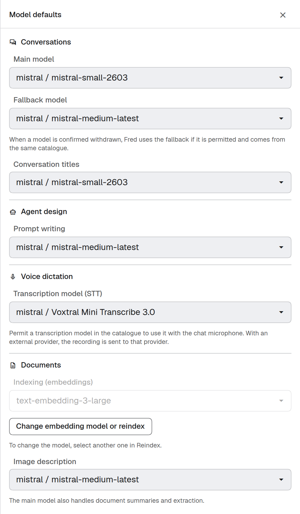
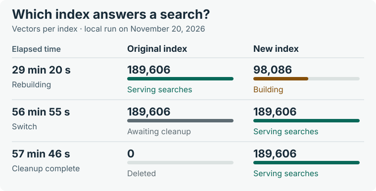

“If an entire region goes offline, where is the other copy of our data?” To answer, an assistant needs to find the right passage in a storage guide and explain what it says. In Fred, two different models can do those jobs. Ask the question aloud and a third model can transcribe it first.

For the person asking, it all happens in one conversation. For the organization running Fred, each step involves a choice. Which service gets the audio? Which model writes the answer? What happens to the documents if we change the model that finds them? The model catalogue in the development version of Fred Weaver makes those decisions visible.

**In this article** · [Catalogue](#catalogue) · [Properties](#properties) · [Model selection](#model-selection) · [Re-indexing](#reindexing) · [Trial results](#results)

## Which models can a team use? {#catalogue}

Each tab in the **Models** view represents a source. Open the Mistral tab on our installation and you'll find Voxtral for transcription, a chat model that can also read images, and an embedding model for document search. The **Permitted** switch tells you which ones the organization has approved. The **Default model** badge identifies the one that will answer when no more specific choice has been made.

<figure>
  
  <figcaption>Voxtral and mistral-small are both permitted. Their listed uses explain why only one of them can write the reply.</figcaption>
</figure>

Fred fills in the **Uses** column automatically from the capabilities the provider reports. If synchronization with models.dev is enabled, it can add details such as whether a model accepts images. The organization can add uses with **Edit model uses**. Provider-confirmed capabilities take precedence. **Model defaults** uses this information to show which permitted models fit each job, such as transcription for voice dictation or embeddings for indexing. If a model's use is unknown, the menu flags it so the organization can check compatibility before choosing it.

An organization can also connect its own catalogue or register a single model by its exact identifier. The form distinguishes the address where Fred reads the list of models from the address where it will send requests. That matters when a provider exposes its inventory and its models at different endpoints. Once the list is in, the organization owner chooses which models to permit. For chat, the owner can also set access by team or for personal spaces. A project can narrow the choice it inherits from its team.

<figure style="max-width:30rem;margin-inline:auto">
  
  <figcaption>The connection is set up once for the source. Teams then see its models under the name given to the catalogue.</figcaption>
</figure>

For a catalogue added in Fred, **Edit catalogue** lets the organization rename it, replace the provider token, or change the models.dev synchronization settings. **Refresh** reloads the model list and properties from the provider, then applies the catalogue's saved enrichment settings.

## What can each model do? {#properties}

Open **Properties** on the first row. For this model, the provider confirms text generation, tool calling and reasoning. Support for structured output is still unknown. A team deciding whether to automate form filling can check that capability before choosing the model.

<figure>
  
  <figcaption>Each field shows where its value came from. A team can see which capabilities the provider has confirmed and which details still need checking.</figcaption>
</figure>

In **Properties**, the organization can supply missing information or give the model a more familiar display name. Fred keeps these additions when the catalogue is refreshed. The panel shows a license badge if the provider or models.dev supplies license information. The badge links to the license when a URL is available.

## Which model answers in chat? {#model-selection}

In the **Model defaults** panel below, Voxtral transcribes the spoken question, Mistral Small is the main conversation model, and Mistral Medium helps draft instructions for a new agent. Document indexing uses a different model again. An organization can change its dictation model without rebuilding its library.

<figure style="max-width:35rem;margin-inline:auto">
  
  <figcaption>Follow the Voice dictation or Indexing row to see which model Fred calls for that part of the job.</figcaption>
</figure>

For a reply, **the model the user picks in chat comes first**. With no explicit choice, Fred uses the agent's recommendation. If that is unset, it uses the nearest space default (project, then team), then the organization default. Fred checks permission and availability when the turn starts. A forbidden choice stops the request. The fallback model has a specific purpose. If the provider withdraws the selected model, Fred can use an approved replacement from the same catalogue and provider account.

## How does Fred change models while keeping search available? {#reindexing}

Document search uses *embeddings*. For each passage, the model produces a list of numbers representing its meaning. At search time, it does the same for the question. That's how a question about “the other copy of our data” can find a passage about “geo-redundant storage” among the documents the person may read. Each model learns its own coordinates. Changing the model used for the question means recalculating those coordinates for the passages, too.

Fred builds a **second index** from the passages it has already published, including conversation attachments. It keeps the original files, passage boundaries and access rights. Searches keep using the active index during the build. New indexing and changes to search visibility wait. If the build fails, it can resume from its last checkpoint. Once the replacement is ready, Fred switches the search model and its index together, then deletes the old index.

## What did we learn from 502 documents and 30 questions? {#results}

The 502 documents in our trial contained **about 9 million words**, the equivalent of 30,000 pages at 300 words per page. The collection combined MDN, Kubernetes and Azure documentation with 19 PDFs. On November 20, 2026, we re-indexed it on a local OpenSearch installation.

We moved **189,606 passages** from `mistral-embed` (1,024 coordinates) to `text-embedding-3-large` (3,072). During the rebuild, the assistant retrieved the expected Kubernetes file from the old index. Fred switched after **56 min 55 s** and confirmed cleanup **51 s** later. A full comparison found the same passage identifiers on both sides. Keeping both indexes available took temporary disk space. At 480 documents processed, they occupied a combined 18.95 GB of primary storage, excluding replicas and source files.

<figure>
  
  <figcaption>The original index was still serving searches when its replacement held 98,086 vectors. Both were complete at the switch.</figcaption>
</figure>

We then compared the same 30 questions before and after the switch, in fresh conversations with the same agent and answer model. The model used for indexing and search was the one we changed.

| Across 30 questions | Before | After |
| --- | ---: | ---: |
| Conversations completed without an execution error | 30 | 30 |
| Questions that made a successful document search | 28 | 28 |
| Answers citing the expected file | 22 | 23 |
| Answers judged fully correct | 17 | 15 |
| Answers judged partially correct | 13 | 15 |

Consider the question we started with. In both runs, the assistant cited the right Azure guide and explained how copies are distributed across zones. Both times, it left out the copy in another region. For someone writing a continuity plan, that was precisely the missing detail.

The run let us verify the switch passage by passage. A single answer per question and model gives us too little evidence to rank the models. It does show why we check two outcomes after re-embedding a collection. Did the assistant find the right source? And did it answer the whole question?
