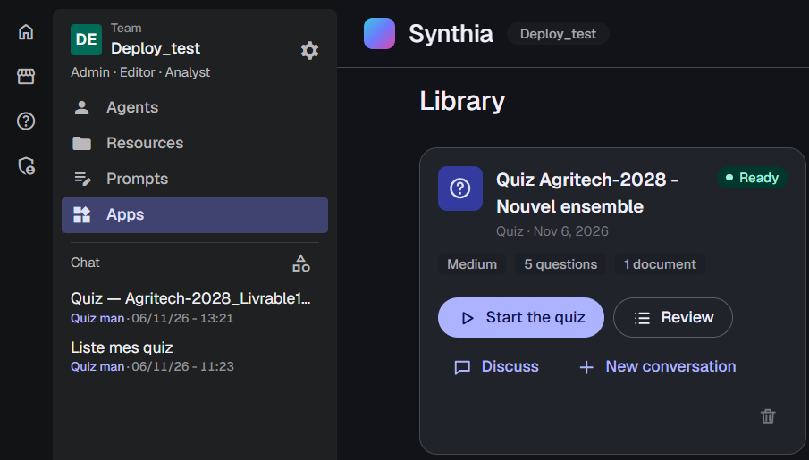
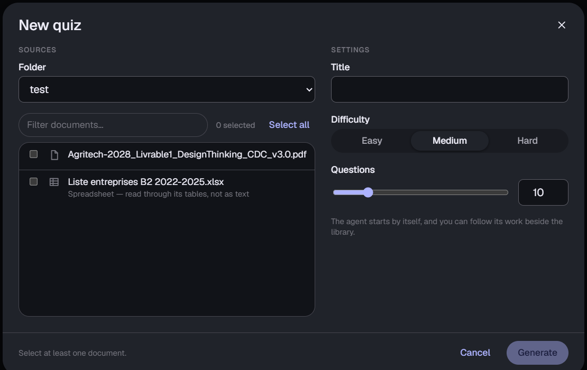
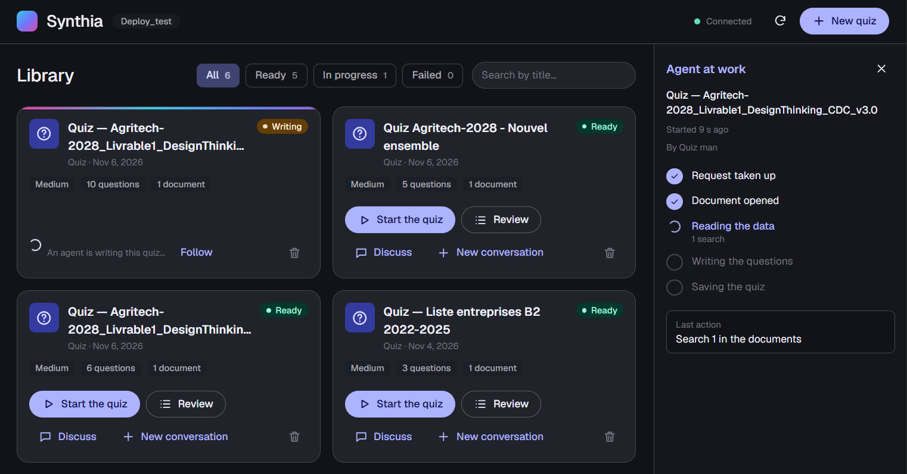
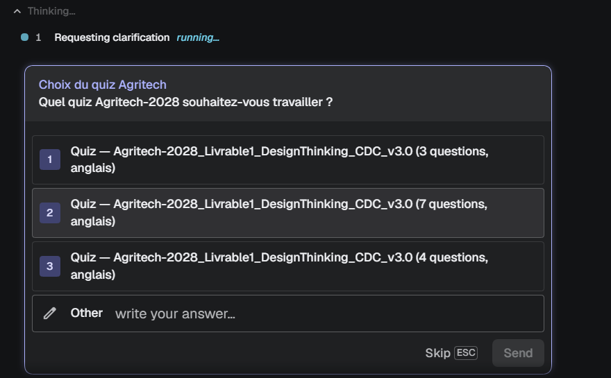
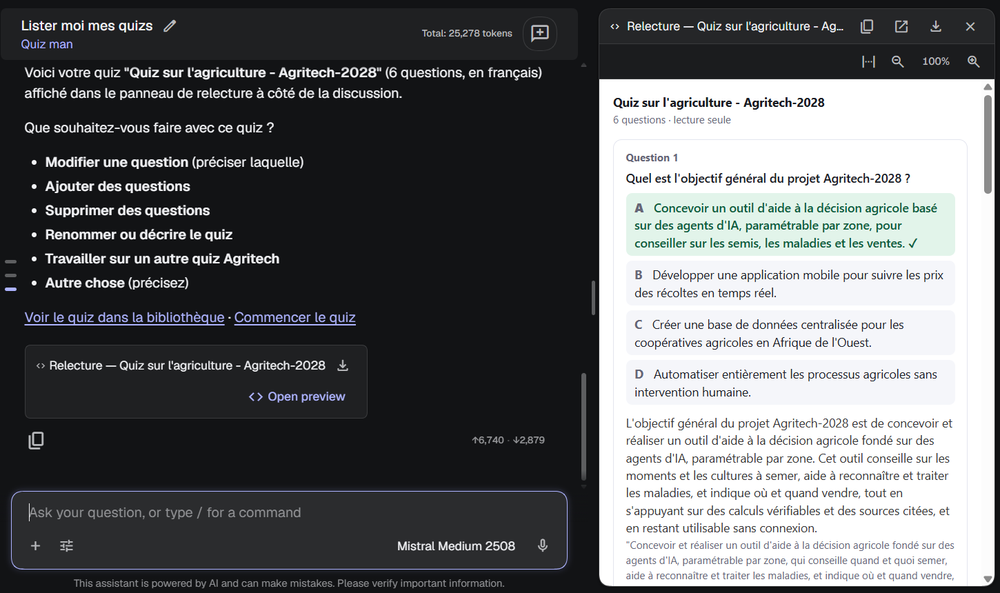
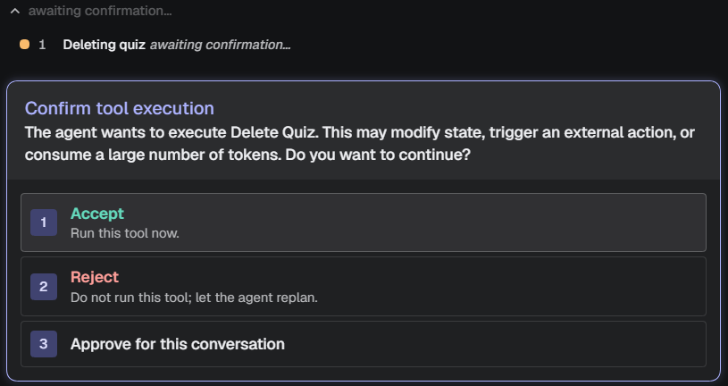
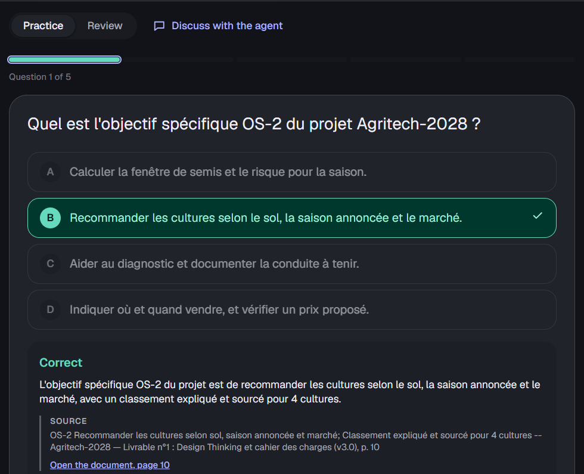
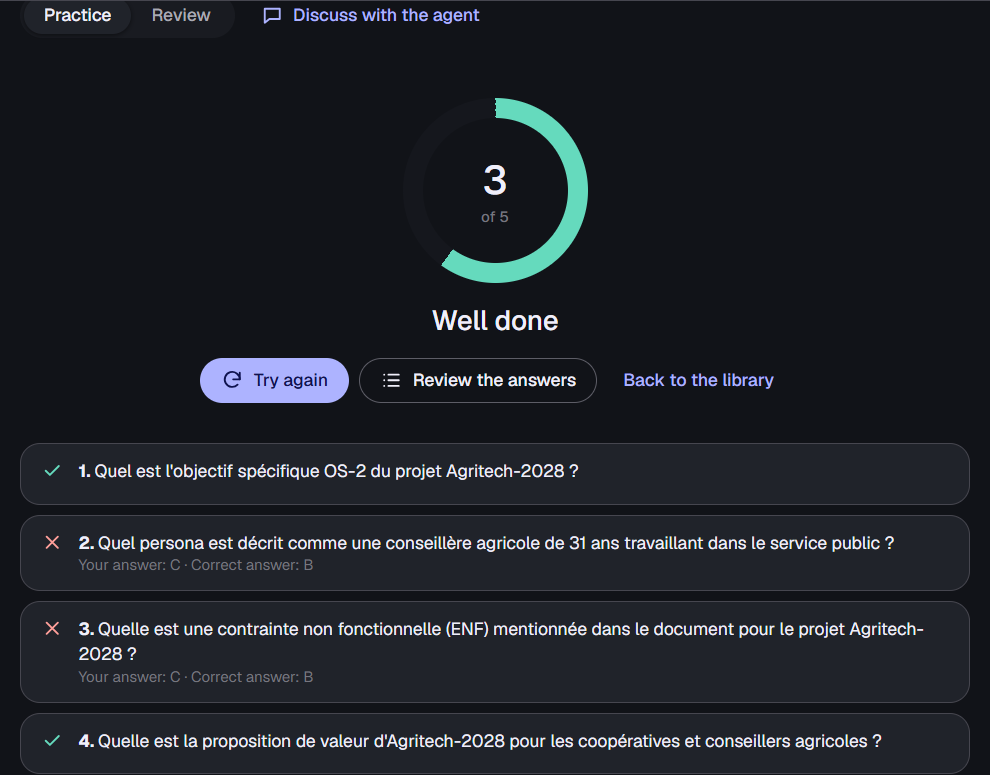

Synthia is a Fred application for capitalizing on a team's documents: turning what is written in them into something people can learn from, check and reuse. Its first module, Synthia Quiz, generates quizzes from those documents. Mind maps and slide decks are planned next, on the same foundations: the application already stores every generation the same way, whatever it produces.

What makes Synthia Quiz worth writing about is not the quizzes themselves, but how it was built: an ordinary business application on one side, an agent on the other, and Fred in between. The agent does the writing, the application keeps the result reliable, and the person moves freely between the two.

That is the point we want to make. Fred is an agentic platform strong enough to combine an agentic system with a business application, and its structure makes the bridge between agents and applications a first-class thing. Synthia Quiz is a telling example.

---

## The problem

Teams need to check that their members master what they are supposed to know: a procedure, a specification, a regulation, the content of a training. Quizzes are a simple way to do it, but writing good ones takes time, and they go stale as soon as the documents change.

Synthia Quiz lets a team build those quizzes from its own documents, the ones already in Fred. Every question comes with its source: the passage it was drawn from, and the document and page it sits on. A collaborator who takes the quiz is measured against what the documents actually say, not against what a model happens to believe, and can open the source when an answer surprises them.

The next step, under way, is to close the loop for the person who launched the quiz: summary dashboards on how the audience did, and a synthesis of the points to review, proposed by the AI from the questions most often missed.

### Why not just ask a chatbot?

Any agent or language model will happily write quiz questions. Two things are missing.

**A single, integrated place.** The quizzes, their sources, the people taking them and the results belong in one application, inside the platform where the documents already live, not scattered across chat transcripts.

**Reliability.** Left to itself, a model writes questions easily, but it does not hold a requested number, it invents sources, and it does not say when a document is not enough. Passing the parameters through the prompt is fragile: the quiz agent Synthia Quiz replaced was asked for thirty questions and returned fifty-four.

---

## How Synthia Quiz works

Three pieces belong to Synthia: a web interface, an API, and an agent running in its own pod. Everything else, from sign-in and permissions to documents and conversations, comes from Fred.

*Synthia inside Fred: the team's quizzes, next to Fred's own menus and conversations.*


%%{init: {'theme':'neutral','flowchart':{'curve':'basis','htmlLabels':true,'nodeSpacing':45,'rankSpacing':55}}}%%
flowchart LR
    P(["Person"])
    subgraph FRED["Fred"]
      UI["Synthia's interface (an iframe in Fred)"]
      CHAT["Fred's chat"]
      KF["Knowledge Flow documents, search, spreadsheets"]
      SEC["Keycloak · OpenFGA identity · permissions"]
    end
    API["Synthia API quizzes · rules"]
    AG["Quiz agent (its own pod)"]
    LLM(["Language model"])

    P --> UI
    P --> CHAT
    UI -- "requests relayed by Fred" --> API
    API -- "starts" --> AG
    CHAT --> AG
    AG -- "MCP tools" --> API
    AG -- "search · SQL" --> KF
    AG --> LLM
    API -. "checks every call" .-> SEC

    classDef syn fill:#e6e9fb,stroke:#3346c4,color:#171a26;
    class UI,API,AG syn;


### A contract between the agent and the application

The agent owns no data. Everything it writes goes through the application's tools, and the tools hold the rules:

- the settings the person chose (how many questions, which difficulty, which documents) reach the agent as **values**, not as a sentence in a prompt it may or may not follow;
- a question whose correct answer is not among its choices is refused;
- more questions than asked is refused; fewer is accepted only with a stated reason, which the application then shows: twelve real questions beat thirty with eighteen inventions;
- a spreadsheet is read with SQL through Fred's tabular tools, so a question about a number quotes the result of a query, not an estimate.

### From a click: the agent starts by itself

In Synthia, the person picks documents, a difficulty and a number of questions, then clicks *Generate*.

*The new quiz form: a folder, the documents (a spreadsheet is read through its tables), the difficulty and the number of questions.*

The API starts the agent itself, and holds its stream: the tab can be closed, the generation goes on. A panel beside the library follows the agent's work, from the names of the tools it calls, never their content.

*The agent at work: the panel beside the library follows its stages.*

At the end, the panel says how many questions are ready, and why there are fewer when the documents did not cover the request.

Fred makes this possible without giving the application the person's token. The application's page never holds one: Fred attaches it to the requests it relays. Once the agent is running, Fred's delegation lets it speak for the person with a token of its own, renewable, while every call is still checked against the person's own rights.

### In a conversation: an agent that reshapes quizzes

The same agent is available in Fred's chat, where it can do far more than generate:

- find any of the team's quizzes by name and work on several in one conversation;
- rewrite one question, add some, remove others: *"keep the first three questions and add two on the sensors"*;
- create a new quiz from documents, asking the missing details with Fred's question tool, multiple choice included;
- combine existing quizzes into a new one. The questions are copied by the application, exactly as stored, sources included, never retyped by the model;
- delete a quiz, which Fred confirms with the person before the tool even runs;
- show the quiz beside the chat, read-only, after each change.

*When several quizzes fit, the agent asks which one, with the candidates as choices, through Fred's question tool.*

*The quiz shown beside the chat, read-only, with the links back to Synthia.*

*Before a quiz is deleted, Fred asks the person: the tool runs only once they accept.*

### Taking the quiz

Collaborators take the quiz in Synthia: one question at a time, with the explanation and its source after each answer, then a score. Every source opens in Fred's own document viewer, at the page it quotes.

*Practice mode: the answer, the explanation and the quoted source, with a link to the page in the document.*

*The score, question by question.*

*Screenshots from a test deployment. The interface is in English; the questions follow the language of the documents, here French.*

---

## What is novel and what is not

**Not novel:** generating questions from retrieved passages is ordinary RAG, and the agent is a standard ReAct agent from Fred's SDK. We did not invent a new way to write questions.

**What is worth a closer look:**

- **The contract.** The model is free in how it writes, never in what the application accepts. Counts, answers and sources are checked by code, not by instructions.
- **Honest shortfalls.** When the documents do not support the number of questions asked, the quiz says so instead of padding.
- **Agents started by applications.** An application can start an agent on the person's behalf and follow its work, without ever holding the person's credentials.
- **Copying beats retyping.** Wherever content already exists, the application moves it; the model never rewrites what it should only move.

**What we learned the hard way:** instructions are not guarantees. Two real incidents during testing:

1. A source quote ran past the length the API accepts. The refusal reached the agent with no reason attached, and the agent, guessing, cut its questions down to two choices to get through. The fix: a longer limit, shorter quotes asked in the instructions, and four choices stated explicitly.
2. Asked to create a quiz before it had the tool to do so, the agent reused a pending link meant for another quiz, and renamed an existing one. The fix was not a better prompt but a rule in the API: that link can only be taken by a conversation that works on no quiz yet.

The pattern is the same each time: what must always hold belongs in the application's code, and the prompt only says how to work well within it.

---

## What is still missing

- **Results.** Answers are not stored yet. Recording them is what the dashboards, the sharing of quizzes across a team and the AI's synthesis of the points to review are waiting for.
- **Checking the grounding.** Every question cites a source, but nothing yet verifies automatically that the quote supports the answer.
- **Tool errors the agent can read.** Fred currently hides the reason for a tool's refusal from the agent, which then corrects its call by guesswork.
- **A review panel identical to the application's.** Today the model draws the quiz beside the chat; a tool producing that view directly would make it exact every time, at no token cost.

---

## References

- [From CSV to Agent: Tabular Data Gets Smart in Fred](/blog/from-csv-to-agent-tabular-data-gets-smart-in-fred/), on the tabular tools Synthia uses to read spreadsheets.
- [Excel, but Agent-Ready](/blog/excel-but-agent-ready-how-fred-turns-spreadsheets-into-queryable-knowledge/), on how Fred extracts tables from Excel workbooks.
- [Relationship-Based Access Control in Fred with OpenFGA](/blog/relationship-based-access-control-in-fred-with-openfga/), on the permissions every Synthia call is checked against.
